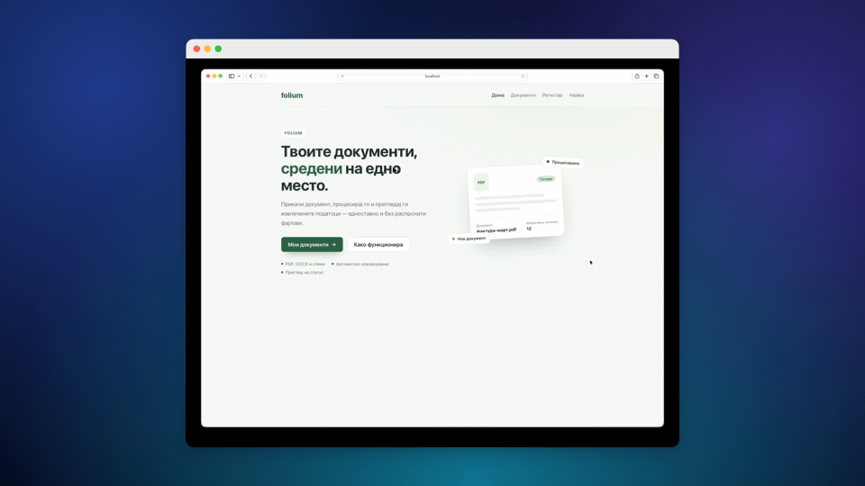
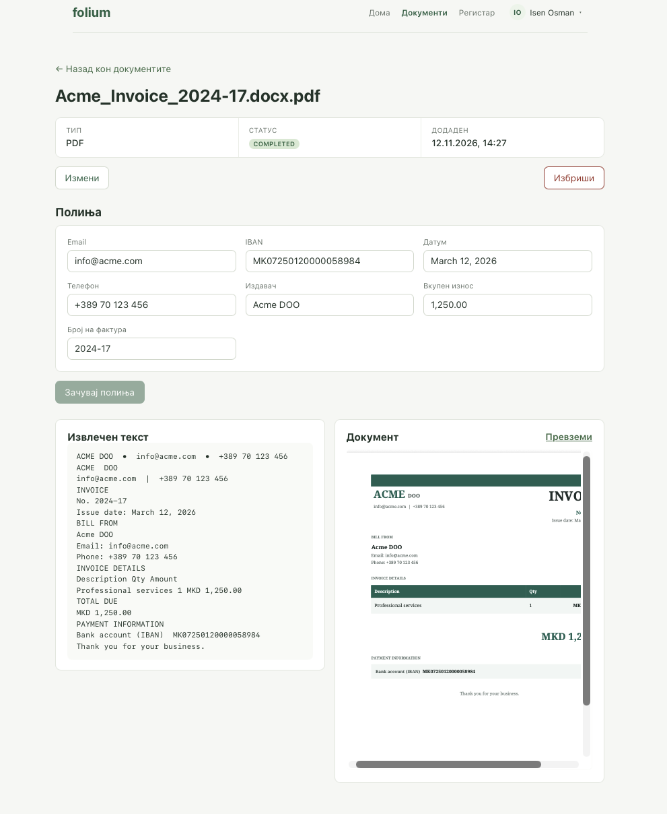
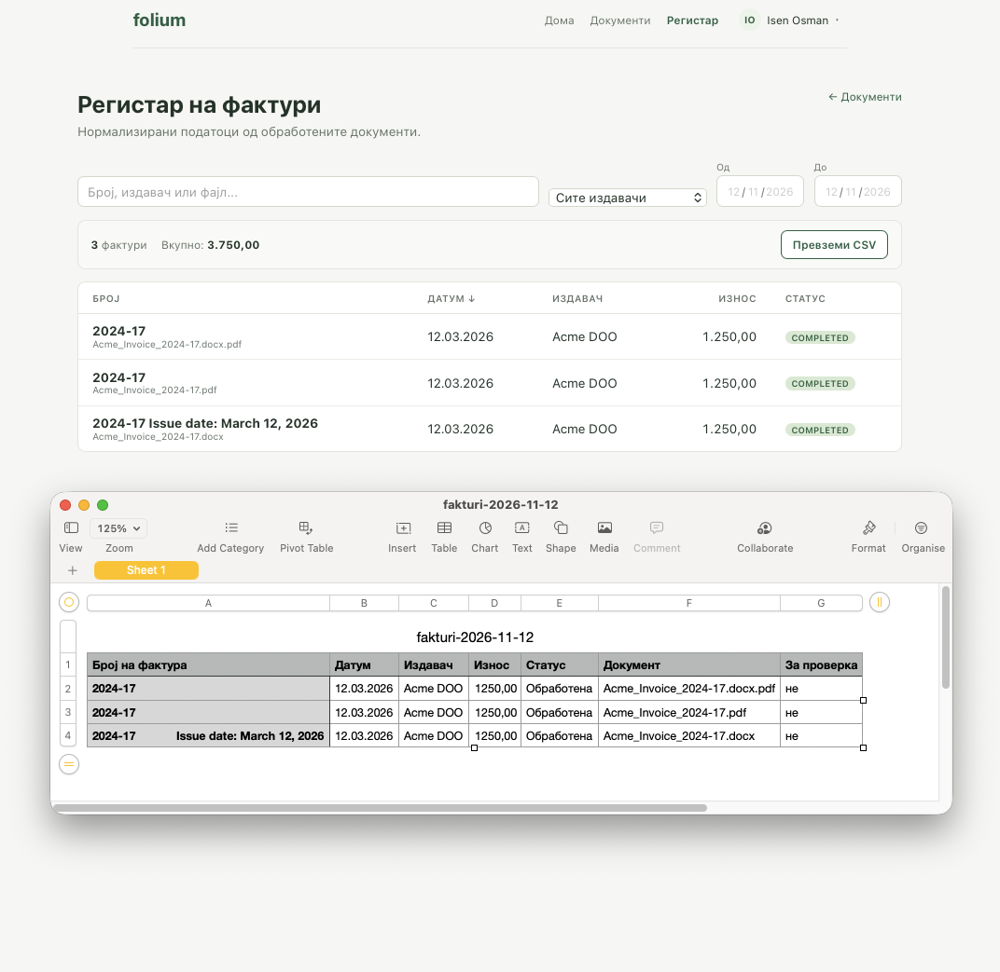

# Folium

Folium is a full-stack invoice processing app. Upload PDF, DOCX, or image invoices; the
backend extracts text (native or OCR), pulls out invoice fields with regex rules, and lets you
review, correct, and export everything to a register.

## Problem statement

Small and medium-sized businesses receive invoices in many formats — PDF, DOCX, and scanned
images. Processing them often means opening each document manually, finding the important
fields, and copying them into spreadsheets or other systems. It is time-consuming and prone
to errors.

Folium automates this by extracting text and recognizing key invoice data: invoice number,
date, issuer, total amount, email, IBAN, and phone number. The extracted data is organized in
a central register, where the user can review, correct, and export it to CSV.

The goal is to reduce manual work, simplify invoice processing, and improve document
organization, while keeping the user in control of automatically extracted data.

---

## Demo

The whole stack — database, backend, and frontend — runs with **one Docker command**.

<p align="center">
  
</p>

### Screenshots

| Document details | Register (Excel-style table) |
|------------------|------------------------------|
|  |  |

---

## Features

- Register and log in with JWT-based authentication (BCrypt password hashing).
- Upload invoices as PDF, DOCX, PNG, JPG, JPEG, GIF, BMP, TIFF, or WEBP (up to 20 MB).
- Extract text from:
  - PDFs with a text layer via PDFBox,
  - scanned PDFs by rendering pages at 300 DPI and running Tesseract OCR,
  - DOCX files via Apache POI,
  - images via Tesseract OCR.
- Pull invoice fields with regex and label-based rules: invoice number, date, issuer,
  total amount, email, IBAN, and phone number.
- Review raw text, preview the original file, and correct extracted fields in the UI.
- Register view with a `needsReview` flag for incomplete invoices.
- Export the register to CSV with spreadsheet formula-injection protection.
- Batch processing through a bounded async executor.
- Owner-scoped document access (a user can only see their own invoices).
- OpenAPI documentation via Swagger UI.

---

## Tech stack

| Layer      | Technology                                                        |
|------------|-------------------------------------------------------------------|
| Backend    | Spring Boot 4 · Java 21 · Spring Security · Spring Data JPA       |
| Frontend   | Angular 22 · standalone components · signals                      |
| Database   | PostgreSQL 16                                                     |
| Auth       | JWT (HS256), BCrypt passwords                                     |
| Extraction | PDFBox (PDF) · Apache POI (DOCX) · Tess4J / Tesseract (OCR)       |
| Docs       | springdoc OpenAPI / Swagger UI                                    |
| Runtime    | Docker · Docker Compose · nginx                                   |

---

## Project structure

```text
Folium/
├── backend/                  # Spring Boot API
│   ├── src/main/java/com/folium/backend/
│   │   ├── web/controllers/  # REST endpoints
│   │   ├── service/          # application + domain logic
│   │   ├── extraction/       # PDF / DOCX text extraction
│   │   ├── ocr/              # OCR pipeline (Tesseract via Tess4J)
│   │   ├── repository/       # Spring Data JPA
│   │   ├── dto/              # request/response contracts
│   │   ├── config/           # security and app configuration
│   │   └── model/            # JPA entities + enums
│   ├── Dockerfile
│   └── pom.xml
├── frontend/                 # Angular SPA
│   ├── src/app/
│   │   ├── core/             # auth, HTTP, guards, models
│   │   ├── features/         # routed pages
│   │   ├── layout/           # header
│   │   └── shared/           # reusable components
│   ├── Dockerfile
│   └── nginx.conf
├── assets/                   # demo GIF and screenshots
├── docs/architecture.md      # diagrams and design details
├── docker-compose.yml
├── .env.example
└── README.md
```

---

## Quick start (Docker)

### Prerequisites
- [Git](https://git-scm.com/)
- [Docker Desktop](https://www.docker.com/products/docker-desktop/) installed and running
  (it includes Docker Compose v2)

### 1. Clone the repository

```bash
git clone https://github.com/Isen-Osman/Folium.git
cd Folium
```

### 2. Create the environment file

```bash
printf 'JWT_SECRET=%s\n' "$(openssl rand -hex 32)" > .env
```

> `.env` is git-ignored. On Windows, copy `.env.example` to `.env` and set the value manually.

### 3. Start everything

```bash
docker compose up --build -d
```

That's it. Compose builds the images and starts PostgreSQL, the Spring Boot API, and the
Angular client served by nginx.

### 4. Open the app

| What            | URL                                     |
|-----------------|-----------------------------------------|
| Application     | http://localhost:4200                   |
| Backend API     | http://localhost:8082                   |
| Swagger UI      | http://localhost:8082/swagger-ui.html   |

Register an account, upload an invoice, and process it.

---

## Docker services

```text
docker-compose.yml
├── db        PostgreSQL 16           host port 5434 → container 5432
├── backend   Spring Boot (Java 21)   host port 8082 → container 8082
└── frontend  Angular build + nginx   host port 4200 → container 80
```

- The backend connects to the database over the internal Docker network (`db:5432`).
- nginx serves the Angular build and proxies `/api/*` to `backend:8082`, so the browser talks
  to a single origin and no CORS setup is needed.
- Uploaded files persist on the host in `./backend/uploads`.
- Database data persists in the named volume `postgres_data`.
- If ports `5434` or `4200` are already in use, change the host side of the mappings in
  `docker-compose.yml`.

### Common commands

```bash
docker compose up --build -d     # build + start everything
docker compose ps                # show service status
docker compose logs -f backend   # follow backend logs
docker compose down              # stop everything (keep database data)
docker compose down -v           # stop everything and delete database data
```

---

## Configuration

The only value you need to provide is `JWT_SECRET` (see `.env.example`). The remaining
variables are defined in `docker-compose.yml` for local development.

| Variable                     | Value                              | Set in               |
|------------------------------|------------------------------------|----------------------|
| `JWT_SECRET`                 | required, min 32 chars             | `.env`               |
| `SPRING_DATASOURCE_URL`      | `jdbc:postgresql://db:5432/folium` | `docker-compose.yml` |
| `SPRING_DATASOURCE_USERNAME` | `folium_user`                      | `docker-compose.yml` |
| `SPRING_DATASOURCE_PASSWORD` | `FoliumDev2026!` (dev only)        | `docker-compose.yml` |

---

## How it works

1. The user uploads an invoice (PDF, DOCX, or image).
2. The backend stores the file and extracts text:
   - PDF with a text layer → PDFBox
   - Scanned PDF or image → rendered at 300 DPI, then Tesseract OCR
   - DOCX → Apache POI
3. Regex and label-based rules extract fields such as invoice number, date, issuer, and
   total amount.
4. The user reviews and edits fields in the UI, with a preview of the original file.
5. The register shows all invoices, flags rows that need review, and can be exported to CSV.

For diagrams, the data model, status lifecycle, and detailed API surface, see
[docs/architecture.md](docs/architecture.md).

### Engineering highlights

- Layered backend: controllers → application services → domain rules → adapters.
- Document status is a state machine; invalid transitions are rejected.
- Batch processing runs off-request on a bounded executor (2–4 threads, queue 200).
- Files live on disk, only metadata and paths in PostgreSQL.
- CSV export is done client-side and guards against formula injection.
- Every document lookup is scoped to the authenticated owner.

---

## API overview

| Method | Path                                       | Purpose                          |
|--------|--------------------------------------------|----------------------------------|
| POST   | `/api/auth/register`                       | Create an account                |
| POST   | `/api/auth/login`                          | Issue a JWT                      |
| GET    | `/api/documents`                           | List the owner's documents       |
| POST   | `/api/documents`                           | Upload a file (multipart)        |
| GET    | `/api/documents/{id}`                      | Document metadata                |
| PATCH  | `/api/documents/{id}`                      | Rename a document                |
| DELETE | `/api/documents/{id}`                      | Delete a document and its file   |
| GET    | `/api/documents/{id}/file`                 | Inline original file             |
| GET    | `/api/documents/{id}/extracted-data`       | Raw text and extracted fields    |
| PUT    | `/api/documents/{id}/extracted-data/fields` | Replace extracted fields        |
| GET    | `/api/documents/register`                  | Register rows                    |
| POST   | `/api/processing/{id}`                     | Process one document             |
| POST   | `/api/processing/batch`                    | Queue documents (202 Accepted)   |
| GET    | `/api/processing/{id}/jobs`                | Processing history               |

All endpoints except `register` and `login` require `Authorization: Bearer <token>`.
Full documentation is available at `/swagger-ui.html`.

---

## Testing

```bash
# backend unit tests
(cd backend && ./mvnw test)

# frontend tests
(cd frontend && npm test)
```

Tests currently cover the extraction rules (`FieldExtractionService`, `InvoiceFieldParser`,
`DocumentTypeDetector`), response mapping, and the CSV export helper.

---

## Local development (optional, without Docker)

### Backend
Requires PostgreSQL on `localhost:5434` (or set `SPRING_DATASOURCE_URL`).

```bash
cd backend
JWT_SECRET=dev-secret-at-least-32-characters-long ./mvnw spring-boot:run
```

### Frontend

```bash
cd frontend
npm install
npm start
```

The dev server runs on http://localhost:4200 and proxies `/api` to
`http://localhost:8082` via `proxy.conf.json`.

---

## Author

**Isen Osman** — [github.com/Isen-Osman](https://github.com/Isen-Osman)
