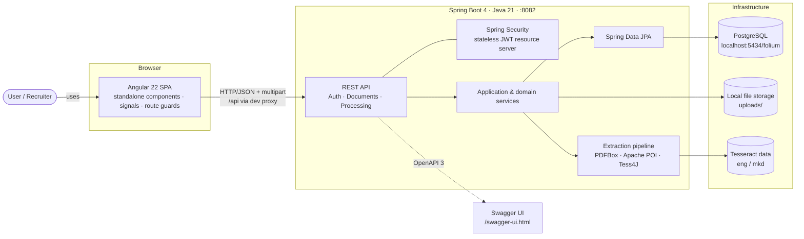
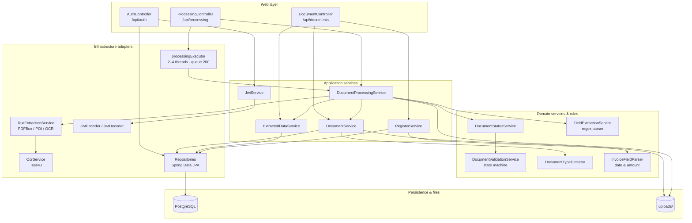
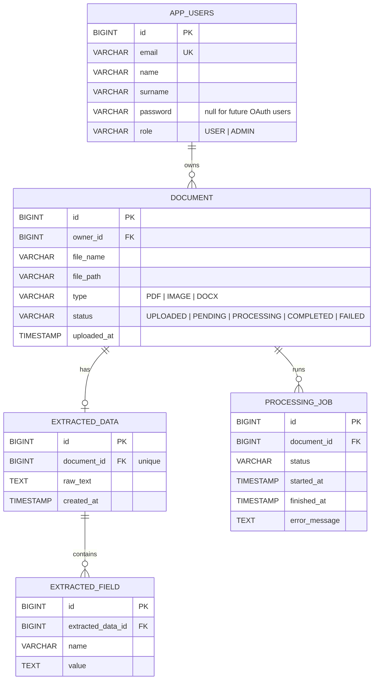
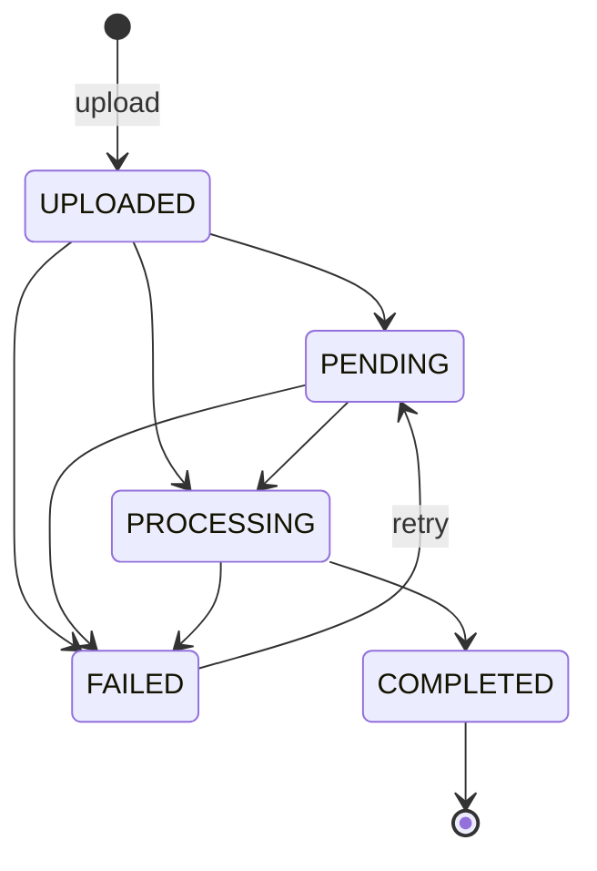
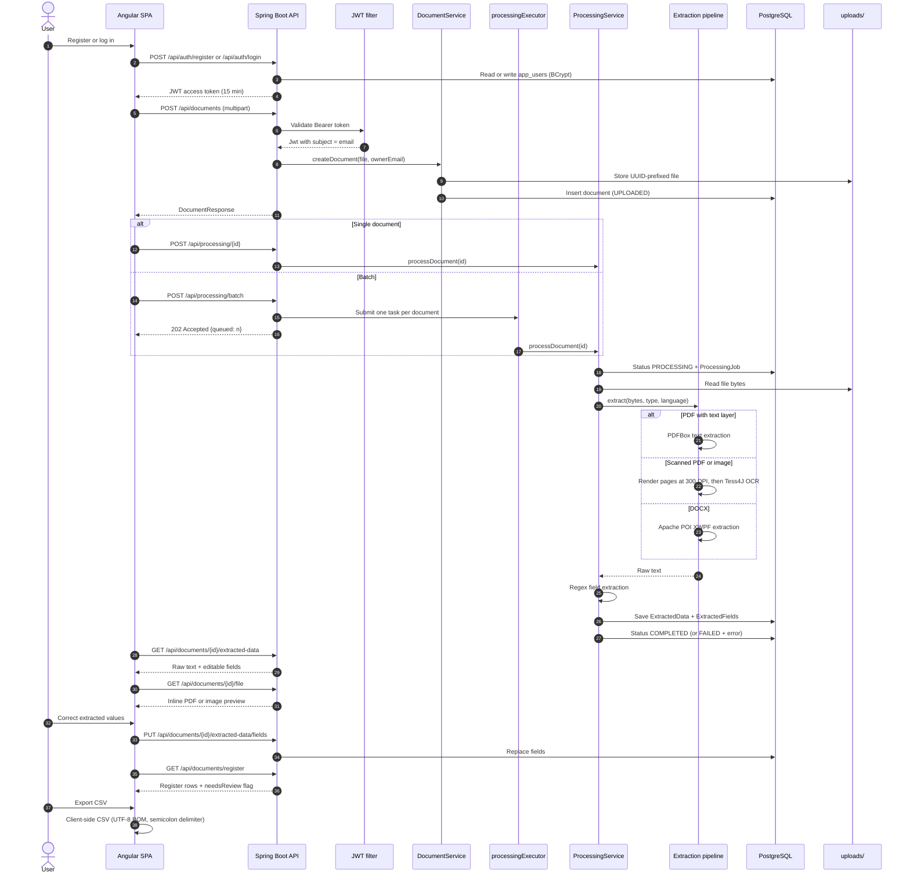
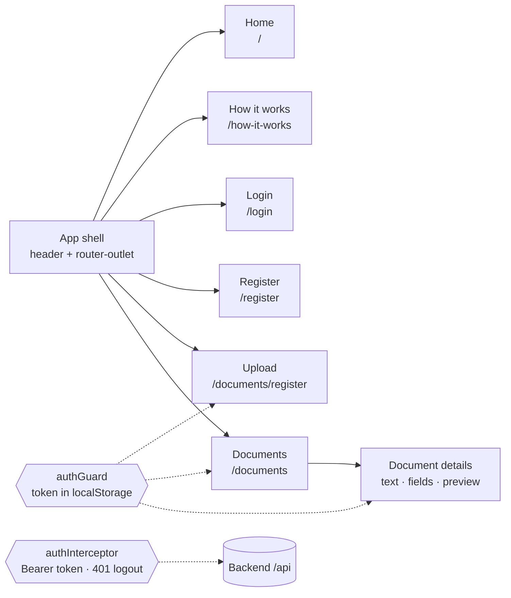

# Folium — Architecture

Folium is a full-stack invoice processing application. Users upload PDF, DOCX, or image
invoices, the backend extracts text (native text extraction or OCR), regex-based rules pull
out invoice fields, and the user verifies the results in a register that can be exported to CSV.

> All diagrams below are Mermaid and render directly on GitHub.

---

## Project structure

```text
Folium/
├── backend/                                  # Spring Boot 4 REST API (Java 21, Maven)
│   ├── src/main/java/com/folium/backend/
│   │   ├── BackendApplication.java           # Application entry point
│   │   ├── config/                           # Cross-cutting configuration
│   │   │   ├── SecurityConfig.java           # Stateless JWT, BCrypt, route rules
│   │   │   └── AsyncConfig.java              # processingExecutor thread pool
│   │   ├── web/controllers/                  # REST endpoints (HTTP ↔ DTO only)
│   │   │   ├── AuthController.java           # /api/auth
│   │   │   ├── DocumentController.java       # /api/documents
│   │   │   └── ProcessingController.java     # /api/processing
│   │   ├── dto/
│   │   │   ├── request/                      # Incoming payloads + Bean Validation
│   │   │   └── response/                     # Outgoing projections
│   │   ├── service/
│   │   │   ├── application/                  # Orchestration, transactions, JWT
│   │   │   └── domain/                       # Pure rules: status, type, parsing
│   │   ├── extraction/                       # Text extraction (PDFBox/POI/OCR)
│   │   ├── ocr/                              # Tess4J / Tesseract adapter
│   │   ├── repository/                       # Spring Data JPA DAO layer
│   │   └── model/
│   │       ├── domain/                       # JPA entities
│   │       └── enums/                        # Document & user enums
│   ├── src/main/resources/application.yaml   # Port, datasource, JWT, uploads
│   ├── src/test/java/com/folium/backend/     # Unit tests
│   ├── uploads/                              # Stored files (runtime)
│   └── pom.xml                               # Dependencies & build
├── frontend/                                 # Angular 22 SPA (standalone + signals)
│   ├── src/
│   │   ├── app/
│   │   │   ├── app.ts / app.html / app.scss  # App shell
│   │   │   ├── app.config.ts                 # Providers, interceptor registration
│   │   │   ├── app.routes.ts                 # Route table
│   │   │   ├── core/                         # App-wide singletons
│   │   │   │   ├── guards/auth.guard.ts      # Protect private routes
│   │   │   │   ├── interceptors/             # Bearer token, 401 logout
│   │   │   │   ├── models/                   # TypeScript API contracts
│   │   │   │   ├── services/                 # AuthService, DocumentsService
│   │   │   │   ├── api-error-message.ts      # Error normalization
│   │   │   │   └── register-csv.ts           # Safe client-side CSV export
│   │   │   ├── features/                     # Page-level views
│   │   │   │   ├── auth/                     # login, register
│   │   │   │   ├── documents/                # upload, list, details, register
│   │   │   │   ├── home/
│   │   │   │   └── how-it-works/
│   │   │   ├── layout/header/                # Top navigation
│   │   │   └── shared/components/            # Status badge & message
│   │   ├── main.ts                           # Bootstrap
│   │   ├── index.html
│   │   └── styles.scss                       # Global styles
│   ├── proxy.conf.json                       # Dev proxy /api → :8082
│   ├── angular.json
│   └── package.json
├── docs/architecture.md                      # This document
└── README.md
```

**Folder responsibilities**

| Folder | Responsibility |
|---|---|
| `backend/web/controllers` | Translate HTTP requests into service calls; never contain business rules. |
| `backend/dto` | Request/response contracts; keeps entities out of the API surface. |
| `backend/service/application` | Transaction boundaries and use-case orchestration. |
| `backend/service/domain` | Framework-light rules (status transitions, type detection, parsing). |
| `backend/repository` | Persistence access only (Spring Data JPA interfaces). |
| `backend/extraction` + `backend/ocr` | Replaceable adapters for PDF/DOCX/OCR text extraction. |
| `frontend/core` | Cross-cutting concerns: auth state, HTTP access, route guards, models. |
| `frontend/features` | Routed pages grouped by domain. |
| `frontend/shared` | Reusable presentational components with no business logic. |

---

## 1. System context



**Tech stack**

| Layer | Technology |
|---|---|
| Frontend | Angular 22 (standalone, signals, Vitest) |
| Backend | Spring Boot 4, Spring MVC, Spring Security, Spring Data JPA |
| Auth | JWT HS256 (15 min), BCrypt passwords |
| Database | PostgreSQL 16 (dev on port 5434) |
| Files | Local disk (`app.upload-dir`, default `uploads/`) |
| Documents | PDFBox (PDF), Apache POI (DOCX), Tess4J + Tesseract (OCR) |
| API docs | springdoc / Swagger UI |

---

## 2. Backend component view



**Layering rules**

- Controllers only translate HTTP ↔ DTOs and read the JWT subject (email).
- Application services own transactions and orchestration.
- Domain services hold pure rules (`DocumentValidationService`, `InvoiceFieldParser`, `DocumentTypeDetector`).
- Every document access is owner-scoped: `findByIdAndOwner_Email(...)`, otherwise `404`.
- Batch processing runs off-request through `processingExecutor`; single processing is synchronous.

---

## 3. Data model



**Design choices**

- `ExtractedData` is one-to-one with a document and stores the full raw text.
- Fields are stored as key/value pairs (`name`, `value`) so new document types do not need
  schema changes. The register projects the keys `Број на фактура`, `Датум`, `Издавач`, and
  `Вкупен износ`.
- `ProcessingJob` is an append-only audit trail of extraction attempts, including failures.
- Uploaded files live on disk; PostgreSQL stores the path, never the blob.

---

## 4. Document status lifecycle



Transitions are enforced by `DocumentValidationService`; invalid transitions throw
`IllegalStateException`.

---

## 5. End-to-end flow



**Extracted fields**

| Field | Source |
|---|---|
| `Email` | first email regex match |
| `IBAN` | first IBAN regex match |
| `Датум` | first date regex match |
| `Телефон` | first international phone match |
| `Издавач` | label-based lookup (`издавач`, `добавувач`, `bill from`, …) |
| `Вкупен износ` | label-based lookup + amount regex |
| `Број на фактура` | label-based lookup, must contain a digit |

`RegisterRowResponse.needsReview` is `true` when any of invoice number, date, issuer, or
amount is missing, so the UI can highlight rows that need human verification.

---

## 6. Frontend structure



- Routes are lazy-loaded standalone components.
- `authInterceptor` attaches `Authorization: Bearer <token>` and redirects to `/login` on 401.
- `authGuard` protects upload and document pages.
- CSV creation is fully client-side and guards against spreadsheet formula injection.

---

## 7. API surface

| Method | Path | Auth | Purpose |
|---|---|---|---|
| POST | `/api/auth/register` | public | Create account |
| POST | `/api/auth/login` | public | Issue JWT |
| GET | `/api/documents` | JWT | List owner documents |
| POST | `/api/documents` | JWT | Upload file (multipart, ≤ 20 MB) |
| GET | `/api/documents/{id}` | JWT | Document metadata |
| PATCH | `/api/documents/{id}` | JWT | Rename |
| DELETE | `/api/documents/{id}` | JWT | Delete document + file |
| GET | `/api/documents/{id}/file` | JWT | Inline original file |
| GET | `/api/documents/{id}/extracted-data` | JWT | Raw text + fields |
| PUT | `/api/documents/{id}/extracted-data/fields` | JWT | Replace fields |
| GET | `/api/documents/register` | JWT | Register rows |
| POST | `/api/processing/{id}` | JWT | Process one document |
| POST | `/api/processing/batch` | JWT | Queue documents (202) |
| GET | `/api/processing/{id}/jobs` | JWT | Processing history |

Swagger UI: `/swagger-ui.html` · OpenAPI JSON: `/v3/api-docs`

---

## 8. Runtime configuration

| Variable | Default | Notes |
|---|---|---|
| `SERVER_PORT` | `8082` | Spring Boot port |
| `SPRING_DATASOURCE_URL` | `jdbc:postgresql://localhost:5434/folium` | PostgreSQL |
| `SPRING_DATASOURCE_USERNAME` | `folium_user` | |
| `SPRING_DATASOURCE_PASSWORD` | `FoliumDev2026!` | dev only |
| `JWT_SECRET` | required | HS256 signing key, no default |
| `app.upload-dir` | `uploads` | Stored files location |
| `TESSDATA_PREFIX` | `/opt/homebrew/share/tessdata` | Tesseract language data |

Uploads are capped at 20 MB per file and 20 MB per request. The Angular dev server proxies
`/api` to `http://localhost:8082` via `frontend/proxy.conf.json`.
